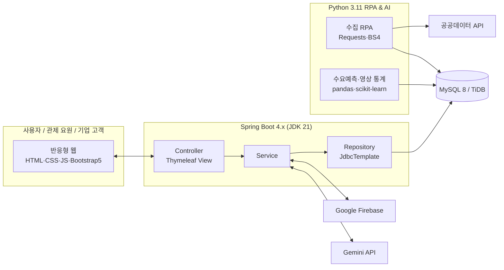

# EzPark 프로젝트 기획서

> **AI 모델 및 K-AI 데이터 분석을 통한 기업 수요 반영 비즈니스 플랫폼 구축**
> 주제: **주차 관련 이동체 인지 영상 데이터를 통한 주차관제 및 유도 시스템**

---

## 1. 프로젝트 개요

| 항목 | 내용 |
| --- | --- |
| 프로젝트명 | EzPark (이지파크) – AI 영상 인지 기반 스마트 주차관제·유도 플랫폼 |
| 수행 인원 | 훈련생 4인 (김길동, 홍기흥, 박미금, 이오리) – 700시간 기본학습 이수자 |
| 수행 기간 | **300시간** (1일 8시간 기준 37.5일, 약 7.5주) |
| 진행 순서 | ① 프론트엔드 → ② 백엔드 → ③ Python RPA & AI → ④ 통합·배포 |
| 산출물 | 반응형 웹 플랫폼, 기획/설계 문서, 데이터 분석 리포트, 발표 자료 |

### 1.1 추진 배경
- 도심 차량 증가로 **주차 공간 탐색에 평균 10분 이상** 소요 → 교통 혼잡·탄소 배출 증가
- 기존 루프 센서·초음파 센서 방식은 **설치/유지 비용**이 높고 면 단위 확장이 어려움
- 이미 설치된 **CCTV 영상 + AI 객체 인지**를 활용하면 저비용으로 면 단위 점유 판단이 가능
- 쇼핑몰·병원·오피스·공공기관 등 **기업 고객의 주차 운영 효율화 수요** 증가

### 1.2 목표
1. K-AI(AI-Hub) **주차 관련 이동체 인지 영상 데이터**를 활용한 차량/사람/이륜차 인지 및 주차면 점유 판단
2. 실시간 **주차관제 대시보드**와 운전자용 **주차 유도(빈자리 안내·경로)** 서비스 제공
3. 공공데이터(전국 주차장 정보) + 이용 로그 기반 **수요 예측 및 기업 맞춤 인사이트(Gemini)** 제공
4. 기업 고객 대상 **B2B 구독형 비즈니스 모델** 설계

### 1.3 핵심 기능

| 구분 | 기능 | 설명 |
| --- | --- | --- |
| 사용자 | 주차장 찾기 | 전국 공영주차장(공공데이터 기반) 검색, 시·도/요금/전기차 필터, 실시간 잔여면 표시 |
| 사용자 | 주차 유도 | 층별 주차면 맵, 빈자리 추천, 입구→주차면 경로 안내 |
| 사용자 | 예약·결제 | 4단계 예약 마법사, 요금 자동 계산, 결제수단 선택 |
| 사용자 | 마이페이지 | 내 차량, 이용내역, 즐겨찾기, 정기권 |
| 관제 | 관제 대시보드 | KPI, 시간대별 점유율, 층별 현황, 실시간 이벤트 로그 |
| 관제 | 영상 인지 모니터링 | 다중 CCTV, 이동체 바운딩 박스, 인지 클래스 필터 |
| AI | K-AI 데이터 분석 | 수요 예측, 요일×시간 혼잡도 히트맵, Gemini 인사이트 챗 |
| 비즈니스 | 기업 솔루션 | 업종별 활용 사례, 요금제, 도입 문의 |
| 운영 | 관리자 | 회원/주차장/기업문의/공지 관리 |
| 공통 | 인증·고객지원 | 로그인/회원가입(Firebase 소셜 로그인 확장), 공지/FAQ/1:1 문의 |

---

## 2. 기술 스택

| 영역 | 기술 |
| --- | --- |
| Frontend | HTML5, CSS3, Vanilla JavaScript, Bootstrap 5, Flexbox |
| Backend | JDK 21, Spring Boot 4.x, Thymeleaf, JdbcTemplate, Lombok, BCrypt |
| Database | MySQL 8.x, TiDB |
| Cloud / External | Google Firebase(소셜 로그인·스토리지), 공공데이터 API |
| AI | Google Gemini API |
| Deployment | Render / AWS EC2 |
| RPA / Data | Python 3.11.9, NumPy, pandas, Seaborn, Matplotlib, Plotly, Requests, BeautifulSoup4, scikit-learn |

### 2.1 시스템 구성도

---

## 3. 팀 구성 및 역할

| 이름 | 역할 | 프론트엔드 | 백엔드 | Python RPA & AI |
| --- | --- | --- | --- | --- |
| **김길동** | 팀장 / PM / 풀스택 리드 | 디자인 시스템, 공통 레이아웃(헤더·푸터·콘솔 사이드바), 메인 페이지 | 프로젝트 셋업, 회원/인증(BCrypt·세션), Firebase 연동, 공통 예외 처리 | 파이프라인 스케줄링, 배포 자동화 |
| **홍기흥** | 사용자 서비스 파트 | 주차장 찾기, 주차 유도, 예약·결제, 마이페이지 | 주차장·주차면·예약·차량 API, 공공데이터 API 연동 | 공공 주차장 정보 수집 RPA (Requests, BS4) |
| **박미금** | 관제 파트 | 관제 대시보드, 영상 인지 모니터링, 관리자, 차트 모듈 | 관제 이벤트·점유 현황 API, 관리자 CRUD | 이동체 인지 영상 라벨 데이터 전처리·통계·시각화 |
| **이오리** | AI · 비즈니스 파트 | AI 데이터 분석, 기업 솔루션, 고객지원, 로그인·회원가입 | Gemini API 연동, 기업문의·공지·FAQ API | 수요 예측 모델(scikit-learn), Plotly 리포트 |

---

## 4. 전체 일정 (300시간)

> 1일 8시간 × 37.5일 기준. 각 단계 종료 시 **코드 리뷰 + 시연(데모 데이)** 진행.

| 단계 | 기간 | 시간 | 주요 산출물 |
| --- | --- | --- | --- |
| P0. 기획·설계 | Day 1 – Day 3 | 24h | 요구사항 정의서, IA/메뉴 구조도, 와이어프레임, ERD 초안, 디자인 가이드 |
| **P1. 프론트엔드** | **Day 4 – Day 13** | **80h** | 반응형 정적 페이지 13종, 공통 CSS/JS, 목업 데이터 |
| P2. 백엔드 | Day 14 – Day 26 | 104h | Spring Boot API, Thymeleaf 전환, DB 구축, 인증/보안, 외부 API 연동 |
| P3. Python RPA & AI | Day 27 – Day 34 | 64h | 수집 RPA, 영상 데이터 분석, 수요 예측 모델, Gemini 인사이트 |
| P4. 통합·배포·발표 | Day 35 – Day 38 | 28h | 통합 테스트, Render/EC2 배포, 최종 보고서, 발표 |
| **합계** |  | **300h** |  |

```mermaid
gantt
    title EzPark 300시간 전체 일정
    dateFormat  X
    axisFormat  D%s
    section P0 기획·설계
    요구사항·IA·와이어프레임        :p0, 1, 3d
    section P1 프론트엔드
    공통 레이아웃·디자인 시스템      :p1a, 4, 2d
    페이지 구현(13종)              :p1b, 6, 6d
    반응형·QA·리뷰                 :p1c, 12, 2d
    section P2 백엔드
    환경 셋업·DB·인증              :p2a, 14, 3d
    도메인 API 개발                :p2b, 17, 6d
    Thymeleaf 전환·외부 API 연동    :p2c, 23, 4d
    section P3 Python RPA & AI
    수집 RPA·전처리                :p3a, 27, 3d
    분석·모델링·Gemini             :p3b, 30, 5d
    section P4 통합·배포
    통합 테스트·배포·발표           :p4, 35, 4d
```

### 4.1 단계별 상세

#### P0. 기획·설계 (Day 1–3, 24h)
| Day | 김길동 | 홍기흥 | 박미금 | 이오리 |
| --- | --- | --- | --- | --- |
| 1 | 주제 분석, 요구사항 정의 리드 | 사용자 시나리오 작성 | 관제 시나리오 작성 | 기업 수요(B2B) 조사 |
| 2 | IA·메뉴 구조도, Git 저장소 구성 | 사용자 화면 와이어프레임 | 관제 화면 와이어프레임 | AI/비즈 화면 와이어프레임 |
| 3 | 디자인 가이드(컬러·폰트·아이콘) 확정 | ERD 초안(주차장·예약) | ERD 초안(이벤트·카메라) | ERD 초안(회원·문의) |

#### P1. 프론트엔드 (Day 4–13, 80h)
> 상세 WBS는 [`02-frontend-plan.md`](./02-frontend-plan.md) 참고

#### P2. 백엔드 (Day 14–26, 104h)
> 상세 WBS·ERD·API 명세는 [`03-backend-plan.md`](./03-backend-plan.md) 참고

| 기간 | 김길동 | 홍기흥 | 박미금 | 이오리 |
| --- | --- | --- | --- | --- |
| Day 14–16 | Spring Boot 4 프로젝트 셋업, 공통 설정, 회원가입/로그인(BCrypt) | MySQL/TiDB 스키마·DDL | 공통 응답·예외 구조 | Thymeleaf 레이아웃(fragment) 전환 |
| Day 17–22 | 세션/권한(관리자), Firebase 소셜 로그인 | 주차장·주차면·예약·차량 CRUD API | 관제 이벤트·점유 현황·카메라 API, 관리자 CRUD | 기업문의·공지·FAQ API, Gemini API 프록시 |
| Day 23–26 | Render/EC2 1차 배포 | 공공데이터 API 연동(주차장 정보) | 대시보드 데이터 바인딩(Fetch) | AI 분석 화면 데이터 바인딩 |

#### P3. Python RPA & AI (Day 27–34, 64h)
| 기간 | 김길동 | 홍기흥 | 박미금 | 이오리 |
| --- | --- | --- | --- | --- |
| Day 27–29 | 파이프라인 구조 설계, 스케줄러 | 공공 주차장 정보 수집 RPA(Requests·BS4) | AI-Hub 이동체 인지 라벨 데이터 전처리(pandas) | 이용 로그 피처 엔지니어링 |
| Day 30–34 | DB 적재 자동화, 결과 API 연결 | 수집 데이터 정합성 검증 | 클래스별 인지 통계·시각화(Seaborn·Matplotlib) | 수요 예측 모델(scikit-learn), Plotly 리포트, Gemini 인사이트 프롬프트 |

#### P4. 통합·배포·발표 (Day 35–38, 28h)
| Day | 전원 공통 |
| --- | --- |
| 35 | 통합 테스트, 버그 수정 |
| 36 | 운영 환경 배포(Render/AWS EC2), 성능 점검 |
| 37 | 최종 보고서·발표 자료 작성, 시연 영상 녹화 |
| 38 (4h) | 최종 발표 및 회고 |

### 4.2 개인별 시간 배분

| 이름 | P0 | P1 FE | P2 BE | P3 Py | P4 | 합계 |
| --- | --- | --- | --- | --- | --- | --- |
| 김길동 | 24 | 80 | 104 | 64 | 28 | 300h |
| 홍기흥 | 24 | 80 | 104 | 64 | 28 | 300h |
| 박미금 | 24 | 80 | 104 | 64 | 28 | 300h |
| 이오리 | 24 | 80 | 104 | 64 | 28 | 300h |

---

## 5. 비즈니스 모델 (기업 수요 반영)

| 요금제 | 대상 | 주요 기능 |
| --- | --- | --- |
| Starter | 소규모 상가·오피스 (≤100면) | 실시간 점유 현황, 기본 대시보드 |
| Business | 쇼핑몰·병원 (≤1,000면) | 영상 인지 관제, 주차 유도, 예약·결제, 월간 리포트 |
| Enterprise | 공공기관·대형 복합시설 | 다중 사이트 관제, 수요 예측, Gemini 인사이트, API 연동 |

---

## 6. 위험 관리

| 위험 | 대응 |
| --- | --- |
| 영상 데이터 용량이 커서 학습 시간 부족 | 라벨(JSON) 메타데이터 중심 통계 분석 + 경량 모델 사용 |
| 외부 API 키 노출 | `.env`/환경변수 관리, 프론트에서 직접 호출 금지(백엔드 프록시) |
| 일정 지연 | 단계별 데모 데이, 기능 우선순위(MUST/SHOULD/COULD) 관리 |
| 협업 충돌 | 페이지 단위 소유권, feature 브랜치 + PR 리뷰 |
