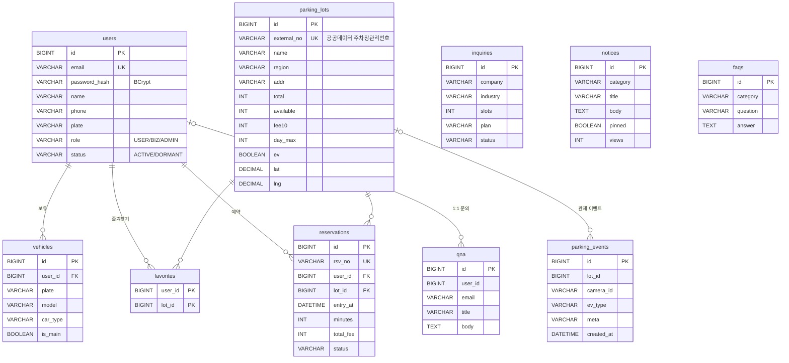

# EzPark 백엔드 기획서 & 업무 분담 (P2)

> 전체 300시간 중 **P2. 백엔드 단계 (Day 14 – Day 26, 104시간/인)**
> 목표: P1 프론트엔드를 Spring Boot + Thymeleaf 로 전환하고, 목업 데이터를 **DB(TiDB Cloud) 기반 REST API** 로 교체한다.

---

## 1. 개발 원칙

1. **기술 스택 준수** – JDK 21, Spring Boot 4.x, Thymeleaf, JdbcTemplate, Lombok, BCrypt / MySQL 8 · TiDB
2. **URL 유지** – P1 과 같은 주소(`/index.html`, `/pages/*.html`)를 유지해 상대경로 링크·스크립트를 그대로 사용
3. **서버가 최종 검증** – 입력값(정규식·범위)과 예약 금액은 서버에서 다시 검증·계산 (클라이언트 값 신뢰 금지)
4. **비밀값 분리** – DB 접속 정보·API 키·관리자 비밀번호는 환경변수/`.env` 로만 주입 (`.env` 는 커밋 금지)
5. **역할 분리** – `frontend/` 는 Netlify 데모(목업), `src/main/resources/` 는 실제 서비스의 기준

## 2. 기술 구성

| 구분 | 사용 기술 | 비고 |
| --- | --- | --- |
| Language / Build | JDK 21 (Temurin), **Gradle 9.7.1** (Wrapper) | `./gradlew` 로 실행, Gradle 설치 불필요 |
| Framework | **Spring Boot 4.1.1** (Spring Framework 7, Tomcat 11) | `spring-boot-starter-webmvc` |
| View | Thymeleaf 3.1 | `templates/fragments/layout.html` 공통 조각 |
| Data | JdbcTemplate (`spring-boot-starter-jdbc`) | JPA 미사용, SQL 직접 작성 |
| 인증 | HttpSession + **BCrypt** (`spring-security-crypto`) | Spring Security 전체가 아닌 crypto 모듈만 사용 |
| 검증 | Bean Validation (`spring-boot-starter-validation`) | DTO record + `@Valid` |
| 편의 | Lombok | `@Getter`, `@Builder`, `@RequiredArgsConstructor`, `@Slf4j` |
| DB | **TiDB Cloud (Serverless)** / MySQL 8 호환 | 로컬 개발은 `local` 프로필의 H2(MySQL 모드) |
| 외부 API | Google Gemini, 공공데이터포털 「전국주차장정보표준데이터」 | 키 미설정 시 대체 동작 |
| 배포 | Dockerfile → Render Web Service / AWS EC2 | P2 Day 23–26 1차 배포 |

## 3. 프로젝트 구조

```
ezpark/
├── build.gradle · settings.gradle · gradlew · gradle/
├── .env.example                 # 환경변수 예시 (복사해서 .env 로 사용, 커밋 금지)
├── Dockerfile · .dockerignore   # Render / EC2 배포 이미지
├── frontend/                    # P1 프런트엔드 (Netlify 데모 – 목업 데이터)
└── src/
    ├── main/java/com/ezpark/
    │   ├── EzparkApplication.java
    │   ├── config/      # EzparkProperties, WebConfig(BCrypt·인터셉터), LoginInterceptor, DbInitializer, GlobalModelAdvice
    │   ├── common/      # ApiException, ApiExceptionHandler, LoginUser(세션), Patterns(정규식)
    │   ├── web/         # PageController – Thymeleaf 화면 + 접근 권한
    │   ├── user/        # 회원가입·로그인 (AuthController, AuthService, UserRepository)
    │   ├── lot/         # 주차장 조회·관리 (LotController, LotRepository)
    │   ├── reservation/ # 예약·요금 계산 (ReservationController, ReservationService)
    │   ├── member/      # 마이페이지: 프로필·내 차량·즐겨찾기 (MeController)
    │   ├── monitor/     # 관제 KPI·이벤트 (MonitorController, EventRepository, ParkingSimulator)
    │   ├── board/       # 공지·FAQ·1:1 문의·기업 도입 문의 (BoardController)
    │   ├── admin/       # 관리자: 회원·문의·공지 (AdminController)
    │   ├── ai/          # Gemini 인사이트 (InsightController, InsightService)
    │   └── publicdata/  # 공공데이터 주차장 동기화 (PublicDataController, PublicParkingSyncService)
    ├── main/resources/
    │   ├── application.yml · application-local.yml
    │   ├── db/schema.sql · db/seed.sql
    │   ├── templates/  (index.html, pages/*.html, fragments/layout.html)
    │   └── static/     (css, js – API 연동 버전)
    └── test/            # FeeCalculationTest, ApiIntegrationTest (H2)
```

## 4. ERD



- `db/schema.sql` : 기동할 때마다 실행 (`CREATE TABLE IF NOT EXISTS`) – MySQL 8 / TiDB / H2(MySQL 모드) 공용 문법
- `db/seed.sql` : `app_seed` 테이블에 기록하여 **최초 1회만** 실행 (전국 공영주차장 10곳, 샘플 회원·문의·공지·FAQ)
- 관리자 계정 : `EZPARK_ADMIN_PASSWORD` 가 설정된 경우에만 최초 기동 시 생성

## 5. API 명세

> 공통 오류 응답: `{"message": "..."}` (400 입력 오류 / 401 로그인 필요 / 403 권한 없음 / 404 / 409 중복·연관 데이터)

| 권한 | Method | URL | 설명 | 담당 |
| --- | --- | --- | --- | --- |
| 공개 | POST | `/api/auth/register` | 회원가입 (BCrypt 해시, 가입 즉시 로그인) | 김길동 |
| 공개 | POST | `/api/auth/login` · `/api/auth/logout` | 로그인(세션 재발급) · 로그아웃 | 김길동 |
| 공개 | GET | `/api/auth/me` · `/api/auth/check-email` | 내 정보 · 이메일 중복 확인 | 김길동 |
| 공개 | GET | `/api/lots` · `/api/lots/{id}` | 전국 공영주차장 목록·상세 | 홍기흥 |
| 로그인 | POST · GET · DELETE | `/api/reservations` · `/me` · `/{rsvNo}` | 예약 생성(서버 요금 계산) · 내 예약 · 취소 | 홍기흥 |
| 로그인 | PUT | `/api/me` | 이름·연락처·비밀번호 변경 | 홍기흥 |
| 로그인 | GET · POST · PATCH · DELETE | `/api/me/vehicles` (`/{id}/main`) | 내 차량 (최대 5대, 대표 차량) | 홍기흥 |
| 로그인 | GET · PUT · DELETE | `/api/me/favorites` (`/{lotId}`) | 즐겨찾기 | 홍기흥 |
| 관제(ADMIN·BIZ) | GET | `/api/dashboard/summary` | KPI (면수·점유율·금일 입출차) | 박미금 |
| 관제(ADMIN·BIZ) | GET | `/api/events?afterId=&limit=` | 실시간 관제 이벤트 (폴링) | 박미금 |
| 관제(ADMIN·BIZ) | POST | `/api/dashboard/insight` | Gemini 인사이트 (키 없으면 규칙 기반) | 이오리 |
| 공개 | GET | `/api/notices` · `/api/faqs` | 공지 · FAQ | 이오리 |
| 공개 | POST | `/api/notices/{id}/view` · `/api/qna` · `/api/inquiries` | 조회수 · 1:1 문의 · 기업 도입 문의 | 이오리 |
| 관리자 | GET · PATCH | `/api/admin/users` (`/{id}/role`, `/{id}/status`) | 회원 목록 · 권한 · 휴면 | 박미금 |
| 관리자 | POST · PUT · DELETE | `/api/admin/lots` (`/{id}`) | 주차장 등록·수정·삭제 | 박미금 |
| 관리자 | GET · PATCH | `/api/admin/inquiries` (`/{id}/status`) | 기업 문의 · 상태 변경 | 박미금 |
| 관리자 | POST · PATCH · DELETE | `/api/admin/notices` (`/{id}/pin`) | 공지 작성 · 고정 · 삭제 | 이오리 |
| 관리자 | POST | `/api/admin/public-data/sync?pageNo=&numOfRows=&keyword=` | 공공데이터 주차장 동기화 | 홍기흥 |

### 화면 접근 권한 (PageController)

| 화면 | 권한 | 미충족 시 |
| --- | --- | --- |
| 메인, 주차장 찾기, 주차 유도, 기업 솔루션, 고객지원, 로그인, 회원가입 | 공개 | – |
| 예약·결제, 마이페이지 | 로그인 | `/pages/login.html?redirect=...` |
| 관제 대시보드, 영상 인지, K-AI 분석 | 관리자·기업 회원 | 로그인 화면 + 권한 안내 |
| 관리자 | 관리자 | 로그인 화면 + 권한 안내 |

## 6. 일정 WBS & 업무 분담 (Day 14 – Day 26, 1일 8h)

| Day | 김길동 (공통·인증·배포) | 홍기흥 (주차장·예약·마이페이지) | 박미금 (관제·관리자) | 이오리 (게시판·AI·화면 전환) |
| --- | --- | --- | --- | --- |
| **14** | Spring Boot 4 프로젝트 생성(Gradle), 패키지 구조, `application.yml` | `schema.sql` – users·parking_lots·reservations | `ApiException`·공통 오류 응답 | `frontend-to-backend.sh` 실행, `fragments/layout.html` |
| **15** | `DbInitializer`, `.env`·TiDB 연결, 관리자 계정 생성 | `seed.sql` – 전국 공영주차장 10곳 | `LoginInterceptor` (로그인/관제/관리자) | 13개 템플릿 fragment 적용 |
| **16** | 회원가입·로그인·로그아웃 API (BCrypt, 세션 재발급) | `LotRepository`·`GET /api/lots` | `parking_events` 스키마, `EventRepository` | `common.js` 서버 버전(세션·API 헬퍼) |
| **17** | `PageController` 화면 권한, `GlobalModelAdvice` | 예약 API – 입력 검증·요금 계산(`ReservationService`) | `ParkingSimulator`(잔여면·이벤트) | 공지·FAQ API, `support.js` 연동 |
| **18** | 회원가입·로그인 화면 연동(`auth.js`) | 예약 화면 연동, 예약번호 발급 | 대시보드 KPI·이벤트 API | 1:1 문의·기업 도입 문의 API |
| **19** | 프로필 수정(`PUT /api/me`) | 내 차량·즐겨찾기 API | `dashboard.js` 연동(폴링) | `enterprise.js` 연동 |
| **20** | 보안 점검 (세션 쿠키·리다이렉트·입력값) | `find.js`·`guide.js`·`mypage.js` 연동 | 관리자 회원·문의 API | Gemini 서버 프록시(`InsightService`) |
| **21** | Firebase 소셜 로그인 설계(선택) | 예약 취소·이용 내역 | 관리자 주차장 CRUD API | `analysis.js` 챗 연동, fallback 답변 |
| **22** | 통합 테스트 작성 (`ApiIntegrationTest`) | 요금 계산 단위 테스트 (`FeeCalculationTest`) | `admin.js` 연동 | 공지 관리 API·화면 |
| **23** | Dockerfile, Render 배포 설정 | 공공데이터 API 동기화(`PublicParkingSyncService`) | 관제 화면 QA | AI 분석 화면 QA |
| **24** | Render/EC2 1차 배포, 환경변수 등록 | 공공데이터 키 발급·동기화 시험 | 이벤트 보존 정책(trim) 점검 | Gemini 키 연결·프롬프트 튜닝 |
| **25** | 운영 로그·오류 점검 | 사용자 화면 QA | 관리자 화면 QA | 고객지원 화면 QA |
| **26** | 코드 리뷰·머지, P2 데모 데이 | 버그 수정 | 버그 수정 | 문서 정리 (API 명세) |

### 6.1 마일스톤

| 시점 | 체크포인트 |
| --- | --- |
| Day 16 종료 | 로컬(H2)·TiDB 모두 기동, 로그인 동작 |
| Day 20 종료 | 사용자 화면(찾기·유도·예약·마이페이지) DB 연동 완료 |
| Day 22 종료 | 관제·관리자·AI 화면 연동, 테스트 통과 (Feature Freeze) |
| Day 26 종료 | Render 1차 배포, P2 데모 데이 |

## 7. 실행 방법

### 7.1 로컬 – DB 설치 없이 (H2)
```bash
./gradlew bootRun --args='--spring.profiles.active=local'
# http://localhost:8080  (관리자: admin@ezpark.kr / ezpark1234 – local 전용)
```
- 재시작하면 데이터가 초기화된다. H2 는 `developmentOnly` 라 배포 jar 에 포함되지 않는다.
- Windows PowerShell 에서는 `.\gradlew.bat bootRun --args="--spring.profiles.active=local"`

### 7.2 TiDB Cloud 연결
1. [TiDB Cloud](https://tidbcloud.com) 에서 Serverless 클러스터 생성 → **Connect** → 연결 방식 `Java(JDBC)` 선택
2. 비밀번호 생성 후 호스트·사용자명 확인
3. 프로젝트 루트에 `.env` 작성 (`.env.example` 복사)
   ```properties
   DB_URL=jdbc:mysql://<host>:4000/ezpark?createDatabaseIfNotExist=true&sslMode=VERIFY_IDENTITY&enabledTLSProtocols=TLSv1.2,TLSv1.3&connectionTimeZone=Asia/Seoul&forceConnectionTimeZoneToSession=true&characterEncoding=UTF-8
   DB_USERNAME=<xxxx.root>
   DB_PASSWORD=<비밀번호>
   EZPARK_ADMIN_PASSWORD=<관리자 비밀번호>
   ```
4. `./gradlew bootRun` → 최초 기동 시 테이블 생성·초기 데이터·관리자 계정이 자동 생성된다.

### 7.3 테스트 · 빌드
```bash
./gradlew test       # 요금 계산 단위 테스트 + API 통합 테스트 (H2)
./gradlew bootJar    # build/libs/ezpark-0.0.1-SNAPSHOT.jar
```

### 7.4 배포 (Render)
1. Render → **New → Web Service** → GitHub `ezpark` 저장소 연결
2. 설정
   | 항목 | 값 |
   | --- | --- |
   | Language(Runtime) | **Docker** (루트 `Dockerfile` 자동 인식) |
   | Branch | `main` |
   | Root Directory / Build·Start Command | 비워 둠 (Dockerfile 이 처리) |
   | Health Check Path | `/api/lots` |
3. **Environment Variables** – 로컬 `.env` 와 같은 값을 등록한다 (`.env` 파일 자체는 GitHub 에 올라가지 않음)
   | 키 | 비고 |
   | --- | --- |
   | `DB_URL`, `DB_USERNAME`, `DB_PASSWORD` | TiDB Cloud 접속 정보 |
   | `EZPARK_ADMIN_EMAIL`, `EZPARK_ADMIN_PASSWORD` | 관리자 계정 (이미 생성된 경우 무시됨) |
   | `GEMINI_API_KEY`, `GEMINI_MODEL=gemini-3.8-flash` | Gemini (`gemini-2.5-flash` 는 신규 사용자 사용 불가) |
   | `PUBLIC_DATA_SERVICE_KEY` | 공공데이터포털 인증키(Decoding) |
   | `SESSION_COOKIE_SECURE=true` | Render 는 HTTPS 이므로 true |
   | `EZPARK_SIMULATOR_ENABLED` | 데모 시뮬레이터 (TiDB 사용량을 줄이려면 false) |
4. 포트는 Render 가 주는 `PORT` 를 자동 사용한다 (`server.port: ${PORT:8080}`).
5. `frontend/` 만 바뀐 커밋은 Netlify 에, 그 외 커밋은 Render 에 반영된다 (Auto-Deploy).
6. 무료 플랜은 15분 동안 요청이 없으면 잠들고, 첫 접속 시 깨어나는 데 1분 정도 걸린다. 잠든 동안에는 시뮬레이터도 멈춘다.

## 8. 보안 체크리스트

| 항목 | 적용 내용 |
| --- | --- |
| 비밀번호 | BCrypt 해시 저장, 평문·해시를 응답에 포함하지 않음 |
| 세션 | 로그인 시 세션 재발급(세션 고정 방지), `HttpOnly`, `SameSite=Lax`, HTTPS 배포 시 `Secure` |
| 권한 | API 인터셉터(로그인/관제/관리자) + 화면 컨트롤러 이중 검사, 본인 권한·휴면 변경 금지 |
| 입력값 | Bean Validation + 서비스 검증(차량번호·연락처·예약 시간·결제수단·쿠폰), 예약 금액 서버 재계산 |
| SQL | JdbcTemplate 바인딩 파라미터만 사용 (문자열 연결 금지) |
| XSS | 서버 데이터 출력 시 `EZ.esc()` 로 이스케이프, Thymeleaf `th:text` 사용 |
| 리다이렉트 | 로그인 후 이동 경로는 사이트 내부 상대경로(`pages/*.html`)만 허용 |
| 외부 키 | Gemini·공공데이터 키는 서버 환경변수로만 사용 (브라우저 노출 없음) |
| 뷰 이름 | `/pages/{name}.html` 는 소문자 영문만 허용 + 등록된 화면만 응답 |

## 9. P3(Python RPA & AI) 연계 포인트

| 항목 | P2 현재 | P3 에서 할 일 |
| --- | --- | --- |
| 잔여면·관제 이벤트 | `ParkingSimulator` 가 5초마다 생성 | Python 영상 인지 결과를 `parking_events`·`parking_lots.available` 에 적재 후 `EZPARK_SIMULATOR_ENABLED=false` |
| 주차장 기본 정보 | 실데이터 10곳 + 관리자 동기화 버튼 | RPA 로 정기 수집·정합성 검증 |
| 수요 예측 차트 | 기준선(`EZ_DATA.hourlyOcc/Pred`) | scikit-learn 예측 결과 테이블 + 조회 API 추가 |
| Gemini 인사이트 | 실시간 주차 현황을 컨텍스트로 질의 | 예측·통계 결과를 컨텍스트에 추가, 일일 리포트 자동 생성 |

## 10. 진행 현황

| 구분 | 상태 |
| --- | --- |
| 프로젝트 셋업 (Spring Boot 4.1.1 · Gradle · 프로필 · .env) | ✅ 완료 |
| DB 스키마 · 초기 데이터 · 관리자 계정 자동 생성 | ✅ 완료 |
| 인증 (회원가입·로그인·세션·BCrypt) · 화면 권한 | ✅ 완료 |
| 주차장 · 예약 · 마이페이지 API 및 화면 연동 | ✅ 완료 |
| 관제 KPI · 이벤트 · 시뮬레이터 · 관리자 API 및 화면 연동 | ✅ 완료 |
| 게시판(공지·FAQ·문의) · Gemini 프록시 · 공공데이터 동기화 | ✅ 완료 (외부 키 등록 후 실연동) |
| Thymeleaf 공통 레이아웃 전환 | ✅ 완료 |
| 테스트 (단위 5 · 통합 7) | ✅ 통과 |
| TiDB Cloud 실연결 · Gemini · 공공데이터 API 실연동 | ✅ 확인 (2026.10.13) |
| Render 배포 | ⏳ GitHub 푸시 후 진행 |
| Firebase 소셜 로그인 | ⏳ 선택 과제 (Firebase 프로젝트 생성 필요) |
